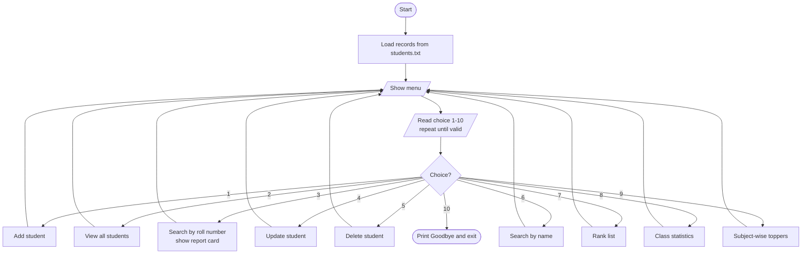
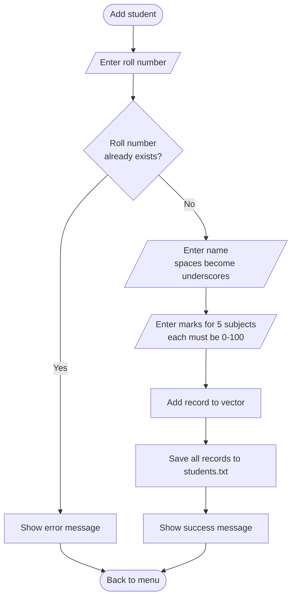
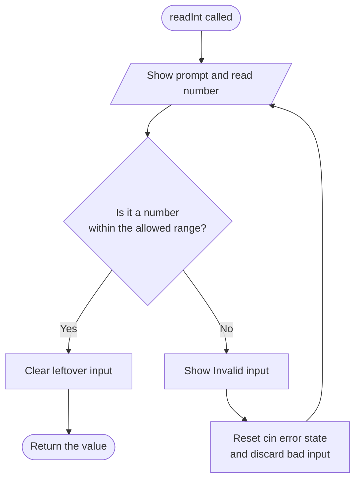
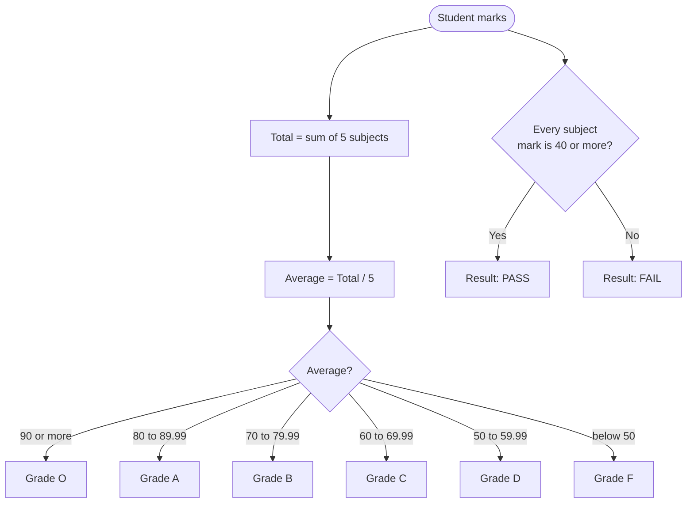
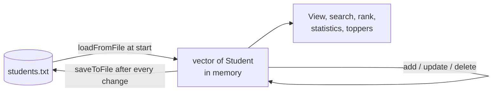

# Student Result Management System

A menu-driven **C++ console application** to store, manage and analyse student academic results. Records are saved to a text file, so your data is still there the next time you run the program.


---

## Table of Contents

- [Features](#features)
- [Demo](#demo)
- [Getting Started](#getting-started)
- [How to Use](#how-to-use)
- [How It Works](#how-it-works)
- [Program Flow](#program-flow)
- [Code Structure](#code-structure)
- [Customisation](#customisation)
- [Limitations and Future Improvements](#limitations-and-future-improvements)
- [Concepts Practised](#concepts-practised)
- [Contributing](#contributing)
- [Author](#author)

---

## Features

| #   | Menu option               | Description                                                                                       |
| --- | ------------------------- | ------------------------------------------------------------------------------------------------- |
| 1   | **Add student**           | Add a record with roll number, name and marks in 5 subjects. Duplicate roll numbers are rejected. |
| 2   | **View all students**     | Shows every record in a table with total, average, grade and PASS/FAIL.                           |
| 3   | **Search by roll number** | Prints a full report card for one student.                                                        |
| 4   | **Update student**        | Edit the name and marks of an existing record.                                                    |
| 5   | **Delete student**        | Remove a record, with a confirmation prompt.                                                      |
| 6   | **Search by name**        | Partial and case-insensitive (typing `arun` finds `Arun S` and `Arun Raj`).                       |
| 7   | **Rank list**             | Students sorted by total marks, highest first. Equal totals share the same rank.                  |
| 8   | **Class statistics**      | Class average, highest and lowest total, pass count and percentage, grade distribution.           |
| 9   | **Subject-wise toppers**  | Shows who scored the highest in each subject.                                                     |
| 10  | **Exit**                  | Closes the program (data is already saved).                                                       |

**Other highlights**

- **Persistent storage:** every add, update and delete is written to `students.txt` immediately.
- **Input validation:** typing letters instead of numbers, or marks outside 0-100, never crashes the program. It asks again.
- **Automatic grading:** grade is calculated from the average marks.
- **Pass rule:** a student passes only if **every** subject mark is at least 40.

---

## Demo

### Main menu

```
===== Student Result Management System =====
1. Add student
2. View all students
3. Search by roll number
4. Update student
5. Delete student
6. Search by name
7. Rank list
8. Class statistics
9. Subject-wise toppers
10. Exit
Enter your choice:
```

### View all students

```
Roll    Name                Total   Average   Grade  Result
-----------------------------------------------------------
101     Arun S              434     86.80     A      PASS
102     Ravi Kumar          308     61.60     C      PASS
103     Meena               380     76.00     B      FAIL
```

### Report card (search by roll number)

```
--------- Report Card ---------
Roll No : 103
Name    : Meena
Subject 1 : 95
Subject 2 : 30 (Below pass mark)
Subject 3 : 80
Subject 4 : 85
Subject 5 : 90
Total   : 380
Average : 76.00
Grade   : B
Result  : FAIL
```

### Rank list

```
Rank  Roll    Name                Total   Average   Grade  Result
-----------------------------------------------------------------
1     101     Arun S              434     86.80     A      PASS
2     103     Meena               380     76.00     B      FAIL
3     102     Ravi Kumar          308     61.60     C      PASS
```

### Class statistics

```
------ Class Statistics ------
Total students : 3
Class average  : 74.80
Highest total  : 434 (Arun S)
Lowest total   : 308 (Ravi Kumar)
Passed         : 2 / 3
Pass percentage: 66.67%
Grade count    : O=0  A=1  B=1  C=1  D=0  F=0
```

### Subject-wise toppers

```
------ Subject-wise Toppers ------
Subject 1 : Meena (95)
Subject 2 : Arun S (85)
Subject 3 : Arun S (88)
Subject 4 : Arun S (92)
Subject 5 : Meena (90)
```

> You can also add screenshots of your own runs in a `screenshots/` folder and link them here.

---

## Getting Started

### Prerequisites

- A C++ compiler with **C++11 or newer** support, such as **g++ (GCC)**, MinGW or Clang.
- The code uses `#include <bits/stdc++.h>`, which is available with GCC/MinGW but **not** with Microsoft Visual C++ (MSVC). If you use MSVC, replace that line with the individual headers:

  ```cpp
  #include <iostream>
  #include <fstream>
  #include <vector>
  #include <string>
  #include <iomanip>
  #include <limits>
  #include <algorithm>
  #include <cctype>
  ```

### Installation and running

1. **Clone the repository**

   ```bash
   git clone https://github.com/<your-username>/<repo-name>.git
   cd <repo-name>
   ```

2. **Compile**

   ```bash
   g++ student_result_management.cpp -o srms
   ```

3. **Run**
   - Linux / macOS: `./srms`
   - Windows: `srms.exe`

### Running in VS Code (Windows)

1. Install MinGW (or MSYS2) and make sure `g++` is in your PATH (check with `g++ --version`).
2. Open the project folder in VS Code.
3. Open the terminal (`Ctrl + ~`) and run the compile and run commands above.

---

## How to Use

1. Start the program. A menu is shown.
2. Type the number of the option you want and press Enter.
3. Follow the prompts. For example, to add a student:

   ```
   Enter your choice: 1
   Roll number: 101
   Name: Arun S
   Marks in Subject 1: 90
   Marks in Subject 2: 85
   Marks in Subject 3: 88
   Marks in Subject 4: 92
   Marks in Subject 5: 79
   Record added successfully!
   ```

4. Choose `10` to exit. Your data is saved automatically in `students.txt` in the same folder.

---

## How It Works

### Data model

Each student is stored in a `struct`, and all students are kept in a `vector<Student>` while the program runs.

```cpp
struct Student {
    int rollNo;
    string name;
    int marks[SUBJECTS];
};
```

### Grading scale

Grade is based on the **average** of the 5 subject marks.

| Average      | Grade |
| ------------ | ----- |
| 90 and above | O     |
| 80 - 89.99   | A     |
| 70 - 79.99   | B     |
| 60 - 69.99   | C     |
| 50 - 59.99   | D     |
| Below 50     | F     |

### Pass / Fail rule

A student is marked **PASS** only if the marks in **every** subject are `>= 40` (`PASS_MARK`). A student can have grade `B` and still **FAIL** if one subject is below 40, as in the Meena example above.

### Rank calculation

The rank list sorts a **copy** of the records by total marks in descending order, so the original order is not changed. Students with the same total share a rank, and the next rank skips ahead (for example 1, 1, 3).

### File storage

Records are saved in `students.txt`, one student per line:

```
101 Arun_S 90 85 88 92 79
102 Ravi_Kumar 60 55 70 65 58
103 Meena 95 30 80 85 90
```

Format: `rollNo name marks1 marks2 marks3 marks4 marks5`

Spaces in names are replaced with `_` while saving (so one line always equals one record) and converted back to spaces when displaying. The file is loaded when the program starts, and rewritten after every add, update or delete.

---

## Program Flow

The diagrams below render automatically on GitHub.

### 1. Overall program flow



### 2. Add student flow



### 3. Input validation flow (`readInt`)



### 4. Result evaluation flow



### 5. Data flow (file storage)



---

## Code Structure

```
.
├── student_result_management.cpp   # complete source code
├── students.txt                    # created automatically on first save
└── README.md
```

### Main functions

| Function                                                             | Purpose                                                           |
| -------------------------------------------------------------------- | ----------------------------------------------------------------- |
| `totalMarks`, `average`, `grade`, `hasPassed`                        | Calculation helpers for one student                               |
| `readInt`                                                            | Reads a whole number in a range; repeats on invalid input         |
| `readName`                                                           | Reads a full name (with spaces) and converts spaces to `_`        |
| `toLower`, `displayName`                                             | String helpers for searching and display                          |
| `findIndex`                                                          | Finds a student by roll number, returns `-1` if not found         |
| `saveToFile`, `loadFromFile`                                         | Read and write `students.txt`                                     |
| `printHeader`, `printRow`                                            | Formatted table output                                            |
| `addStudent`, `viewAll`, `viewOne`, `updateStudent`, `deleteStudent` | Core record operations                                            |
| `searchByName`                                                       | Partial, case-insensitive name search                             |
| `showRankList`                                                       | Sorted ranking using `sort` with a lambda                         |
| `showStatistics`                                                     | Class average, highest/lowest, pass percentage, grade counts      |
| `showSubjectToppers`                                                 | Highest scorer in each subject                                    |
| `main`                                                               | Loads data, shows the menu in a loop, calls the selected function |

---

## Customisation

| What you want to change                    | Where                                     |
| ------------------------------------------ | ----------------------------------------- |
| Number of subjects                         | `SUBJECTS` constant and the `sub[]` array |
| Subject names (for example Maths, Physics) | `sub[]` array at the top of the file      |
| Pass mark                                  | `PASS_MARK` constant                      |
| Grade cutoffs                              | `grade()` function                        |
| Storage file name                          | `FILE_NAME` constant                      |

---

## Limitations and Future Improvements

**Current limitations**

- Number of subjects is fixed (5) at compile time.
- Names are stored with `_` in place of spaces, so a name that genuinely contains `_` will display with a space.
- Data is stored in a plain text file with no encryption or password protection.
- If `students.txt` is edited by hand and becomes malformed, loading stops at the first bad line.

**Ideas for the future**

- [ ] Export results to a CSV file
- [ ] Sort the "view all" table by name or roll number
- [ ] Admin login with a password
- [ ] Support multiple semesters and credit-based CGPA calculation
- [ ] Use classes (OOP) and separate header/source files
- [ ] Store data in a database such as SQLite
- [ ] Unit tests for the grading and ranking logic

---

## Concepts Practised

- `struct` and `vector` for storing records
- Functions and modular program design
- File handling with `ifstream` and `ofstream`
- Sorting with `std::sort` and a lambda comparator
- String handling (`find`, `tolower`, character replacement)
- Input validation using `cin.clear()` and `cin.ignore()`
- Formatted console output using `iomanip` (`setw`, `setprecision`)

---

## Contributing

Suggestions and improvements are welcome.

1. Fork the repository
2. Create a branch: `git checkout -b feature/your-feature`
3. Commit your changes: `git commit -m "Add your feature"`
4. Push the branch: `git push origin feature/your-feature`
5. Open a pull request

---

## Author

**Arun S**
B.E. Computer Science and Engineering, College of Engineering Guindy, Anna University

GitHub: [@itz-Arun-001](https://github.com/itz-Arun-001)
